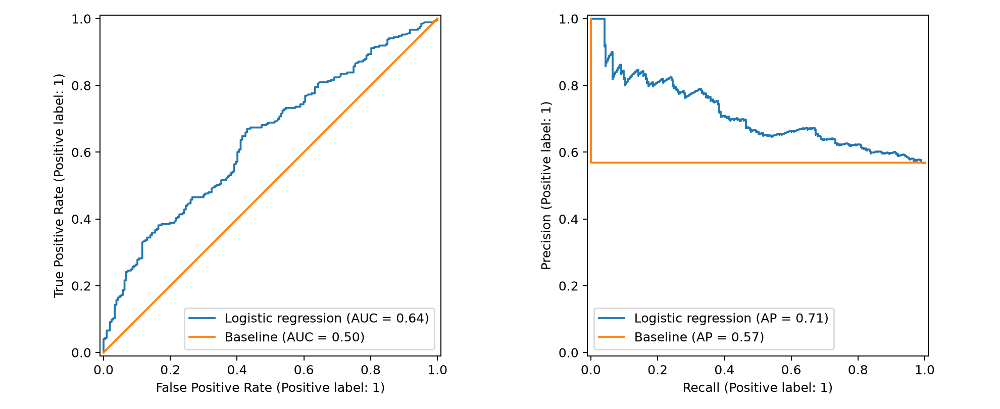
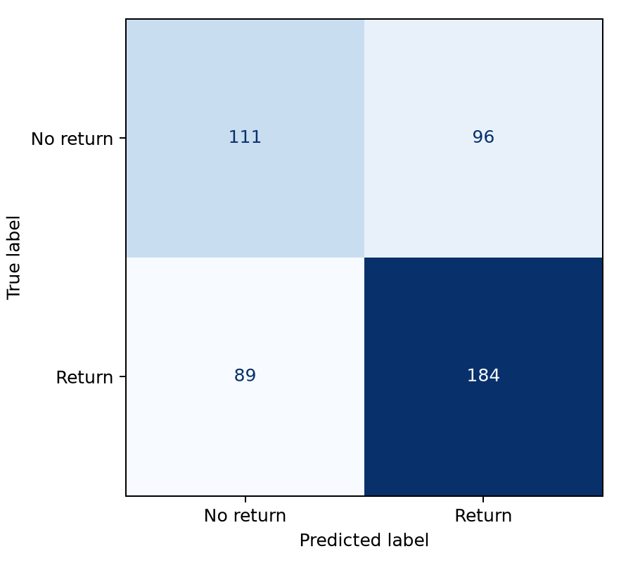

# Результаты эксперимента

Данные синтетические. Модель и порог 0,5 выбраны заранее; настройки по тесту не подбирались.

Обучение: 474 покупателей, май и июнь. Проверка: 480 покупателей, июль и август.
Доля повторных покупок в тесте: 56.9%.

| Метрика | Логистическая регрессия | Базовый прогноз |
|---|---:|---:|
| accuracy | 0.615 | 0.569 |
| precision | 0.657 | 0.569 |
| recall | 0.674 | 1.000 |
| f1 | 0.665 | 0.725 |
| roc_auc | 0.640 | 0.500 |
| average_precision | 0.712 | 0.569 |
| brier_score | 0.230 | 0.245 |

При пороге 0,5: верно предсказано возвращение 184 клиентов; пропущено 89 возвращений; ложных прогнозов возвращения 96; верно предсказано отсутствие возвращения 111.

На этом наборе модель лучше baseline по ROC-AUC, average precision, Brier score и accuracy, но уступает ему по recall и F1 при пороге 0,5. Baseline всегда отвечает «вернётся» и потому не пропускает возвращения, одновременно ошибаясь на всех невозвратившихся клиентах. Улучшение ранжирования не гарантирует улучшения каждой пороговой метрики.

ROC-AUC оценивает ранжирование. Average precision оценивает качество ранжирования положительного класса; ориентир для константного прогноза — доля положительного класса. Brier score — средняя квадратичная ошибка вероятностей (меньше лучше). Accuracy, precision, recall и F1 здесь зависят от выбранного порога.

Baseline назначает всем вероятность, равную доле возвращений в обучении. При пороге 0,5 это превращается в прогноз одного класса. Различие метрик на этом наборе не доказывает качество на реальных клиентах; доверительные интервалы не рассчитывались.

